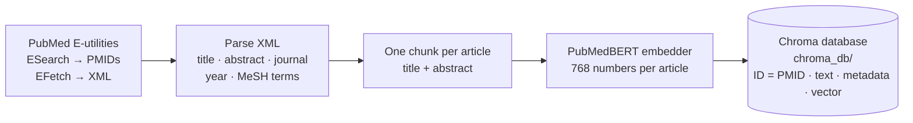
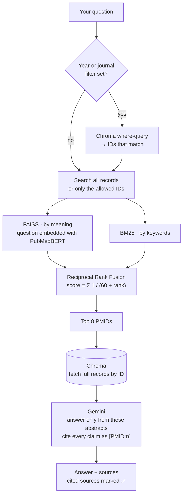

# Medical Literature Q&A (RAG over PubMed)

Ask a medical question in plain English. The app searches PubMed abstracts two ways (by meaning and by keywords), merges the results, and Google Gemini answers using only those abstracts, citing each claim as `[PMID:12345]`.

All the code is in **one file: `app.py`**. The first build creates a `chroma_db` folder next to it: that's the database, managed by Chroma; you never need to open it.

Get the code with `git clone https://github.com/kishoremadanagopal/medical-literature-rag.git`, or on GitHub click **Code → Download ZIP** and unzip it.

## Architecture

**Build the database** (once, from the sidebar):



**Answer a question** (every time). At app start, the vectors in Chroma are loaded into FAISS and the texts into BM25, and kept in memory.



## What you need

- **Python 3.12** (3.10–3.13 work; **3.14+ does not yet**, because FAISS has no build for it). Check with `py -3.12 --version` on Windows or `python3.12 --version` on Mac.
- VS Code with the Python extension (optional, any terminal works)
- A free Gemini API key, for the answers: [aistudio.google.com](https://aistudio.google.com) → **Get API key**
- Internet, and about 3 GB free disk (PyTorch + the embedding model)
- On Windows, keep this folder **outside OneDrive** (e.g. `C:\Users\<you>\RAG`). OneDrive syncing can lock the database files.

## Run it — Windows (PowerShell / VS Code terminal)

```powershell
cd C:\Users\<you>\RAG
py -3.12 -m venv venv
.\venv\Scripts\Activate.ps1
python -m pip install --upgrade pip
pip install -r requirements.txt
Copy-Item .env.example .env
notepad .env
streamlit run app.py
```

- If `Activate.ps1` says scripts are disabled, run `Set-ExecutionPolicy -Scope Process -ExecutionPolicy Bypass`, then activate again.
- When it works, the prompt starts with `(venv)`.
- In `notepad .env`, fill in your Gemini API key and email, then save.

## Run it — Mac / Linux

```bash
python3.12 -m venv venv
source venv/bin/activate
pip install -r requirements.txt
cp .env.example .env      # then edit .env
streamlit run app.py
```

## Every time after that

Open a terminal in the folder, activate the venv (`.\venv\Scripts\Activate.ps1` or `source venv/bin/activate`), and run `streamlit run app.py`.

VS Code's ▶ Run button also works: `app.py` notices it wasn't started by Streamlit and relaunches itself with `streamlit run`. Make sure VS Code is using the `venv` interpreter (**Ctrl+Shift+P → Python: Select Interpreter**).

**First time only:** in the sidebar, keep topic "heart failure", 1000 articles, then click **Build database**. It takes about 10–15 minutes (download, plus embedding on your CPU). Everything is saved in the Chroma database, so next time the app starts in seconds. Stop the app with **Ctrl+C** in the terminal.

## How it works (the 6 steps in app.py)

| Part | Role |
| --- | --- |
| **Chroma** | The database. Stores every article's text, metadata (title, journal, year, MeSH terms) and vector on disk. |
| **FAISS** | The search engine. Loads the vectors from Chroma at startup and finds the closest ones very fast. |
| **BM25** | Keyword search over the same texts. |

1. **Download.** PubMed's API finds matching articles and downloads their abstracts.
2. **Embed and store.** A biomedical AI model turns each abstract into 768 numbers that capture its meaning. Text, metadata and vector are saved in Chroma, with the PMID as the ID.
3. **Load.** At startup the app reads every record from Chroma, puts the vectors into FAISS and the texts into BM25.
4. **Search.**
   - If you set a year or journal filter, Chroma first answers which records match.
   - FAISS ranks articles by meaning and BM25 by keywords (only matching records when filtered).
   - Reciprocal Rank Fusion merges the two rankings.
   - The winners' full records are fetched from Chroma by ID.
5. **Answer.** The records go to Gemini with strict rules: use only these, cite every claim, and say so if they don't answer the question.
6. **Evaluate.** The "Evaluate" tab tests search quality (each article's title is used as a question; does that article come back near the top?) and times FAISS against Chroma's own vector search.

## Tech stack

| Piece | Used for |
| --- | --- |
| [PubMed E-utilities](https://www.ncbi.nlm.nih.gov/books/NBK25501/) (ESearch + EFetch) | Finding and downloading abstracts |
| [`pritamdeka/S-PubMedBert-MS-MARCO`](https://huggingface.co/pritamdeka/S-PubMedBert-MS-MARCO) via sentence-transformers | 768-dimension embeddings (PubMedBERT fine-tuned for search) |
| Chroma | Database: text, metadata and vectors on disk; filters; fetch by ID |
| FAISS (`IndexFlatIP`) | Exact cosine-similarity search in memory |
| rank-bm25 | Keyword search |
| Reciprocal Rank Fusion (k = 60) | Merging the two rankings |
| Google Gemini (`google-genai`) | Writing the cited answer, with retries and fallback models |
| Streamlit | The web page |

## Settings (`.env`)

| Variable | Meaning |
| --- | --- |
| `GEMINI_API_KEY` | Free key from aistudio.google.com. Without it, the app still shows the retrieved sources. |
| `NCBI_EMAIL` | Your email; PubMed's usage policy asks for it. |
| `GEMINI_MODEL` | Main model (default `gemini-3.8-flash`). |
| `GEMINI_FALLBACK_MODELS` | Comma-separated models tried if the main one is busy or rate-limited. |
| `EMBEDDING_MODEL` | Optional: a different sentence-transformers model (rebuild the database after changing it). |

## Known limitations

- **One chunk per article** (title + abstract). The embedding model reads the first 350 tokens, so the end of a very long abstract is not in its vector; BM25 still searches the full text.
- **Evaluation is a known-item test**, not a labelled benchmark. Titles share words with their own abstracts, so it favours keyword search.
- **Rebuild replaces the database**; there is no incremental update yet.
- **No relevance threshold**: an off-topic question still retrieves the closest articles, and the prompt tells Gemini to say it cannot answer.
- **Licence**: the embedding model is CC BY-NC 2.0 (non-commercial). A commercial product would need a differently licensed model.
- This is a research demo, **not medical advice**.

